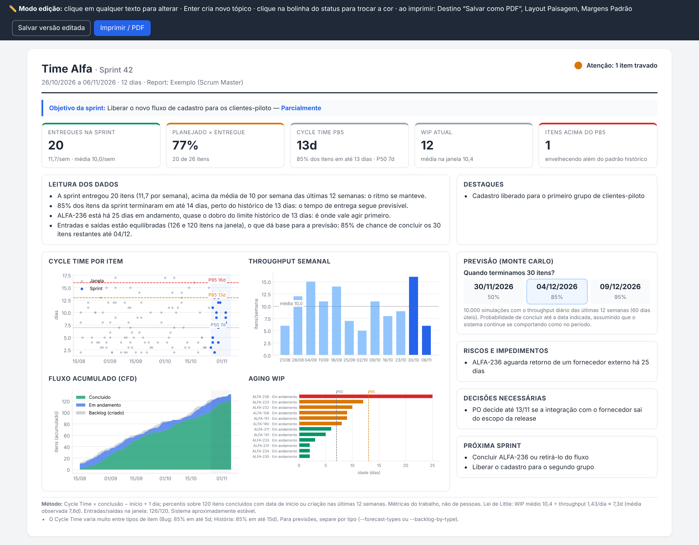

# 📊 one-page-report

> Uma **Agent Skill** para o [Claude](https://claude.ai) e o [Claude Code](https://claude.com/claude-code) que transforma o CSV do **Jira** ou do **Azure DevOps** em métricas de fluxo e previsão probabilística: um **One Page Report de sprint** pronto para enviar ou uma **resposta rápida** para a sua pergunta de fluxo.
>
> An **Agent Skill** for [Claude](https://claude.ai) and [Claude Code](https://claude.com/claude-code) that turns a **Jira** or **Azure DevOps** CSV into flow metrics and probabilistic forecasts: a ready-to-send **sprint One Page Report** or a **quick answer** to your flow question.

<p align="center"><em>🇧🇷 Português abaixo · 🇺🇸 <a href="#-english">English below</a></em></p>

<p align="center"></p>
<p align="center"><sub>Exemplo gerado pela skill com dados fictícios · Example generated by the skill with fictional data</sub></p>

---

## 🇧🇷 Português

### O que é

`one-page-report` ajuda Scrum Masters, Agile Masters e POs a falar de entrega **com dados**. Os números saem de um script Python, calculados direto do CSV exportado da sua ferramenta; o Claude só escreve a narrativa em cima deles. Assim, **qualquer número do report pode ser rastreado até o CSV**.

As métricas seguem **Daniel Vacanti** (Cycle Time, Throughput, WIP, Aging WIP, CFD, Lei de Little) e a previsão segue **Troy Magennis** (Monte Carlo, com percentis em vez de uma data única).

### Os dois modos

| Modo | Quando usar | O que você recebe |
|---|---|---|
| **Report** | Fechar ou reportar uma sprint para PO, gestor ou liderança | HTML de **uma página A4**, editável no navegador, pronto para virar PDF |
| **Análise rápida** | Pergunta pontual de fluxo, time Kanban ou sem datas de sprint | A resposta direta, com o número e o que ele significa para o time, sem documento |

Na dúvida, a skill responde no modo rápido e oferece o report em uma linha. Os dois modos usam as mesmas regras de cálculo, então os números batem entre si.

### O que você pode pedir

Fale em linguagem natural. **Não precisa dizer "one page report".**

| Você pede | Você recebe |
|---|---|
| "Monta o report da sprint 42" / "status da sprint para o PO" | O One Page Report completo, com status sugerido e perguntas para a Retrospectiva |
| "Como está o fluxo do time?" | Cycle Time, Throughput, WIP e estabilidade do sistema |
| "O throughput caiu?" | Últimas 4 semanas contra a mediana e a faixa P15–P85, separando sinal de ruído |
| "Quais itens estão envelhecendo?" | Itens acima do P85, por ID, idade e coluna |
| "Quando terminamos esses 30 itens?" | Faixa de datas com 50%, 85% e 95% de chance |
| "Quantos itens cabem até dezembro?" | Quantidade de itens em cada nível de confiança |
| "E se o escopo crescer 20%?" | A previsão refeita com essa premissa declarada |
| "Previsão só das histórias" | Simulação usando apenas o throughput daquele tipo |

**Não cobre:** report mensal para C-level nem status semanal escrito a partir de notas soltas, sem CSV.

### O que vem no report

- **Cabeçalho:** time, sprint, período, autor e status (verde, amarelo ou vermelho).
- **Objetivo da sprint** e resultado.
- **Indicadores:** entregues na sprint, planejado × entregue (opcional), Cycle Time P85, WIP atual e itens acima do P85.
- **Leitura dos dados:** de 3 a 5 frases, cada uma com um número e o que ele significa, sem jargão para quem lê.
- **Quatro gráficos:** dispersão de Cycle Time, Throughput semanal, CFD e Aging WIP.
- **Previsão Monte Carlo** (quando há itens restantes ou data-alvo).
- **Destaques, riscos e impedimentos, decisões necessárias e próxima sprint.**
- **Rodapé de método** com a checagem da Lei de Little e os avisos de qualidade dos dados.

**Edição sem voltar ao Claude:** os textos são editáveis direto no navegador, e a bolinha de status troca de cor com um clique. Os indicadores, gráficos e a previsão ficam travados: só mudam regerando a partir do CSV, para que ninguém ajuste um número à mão sem rastro. Uma barra no topo salva a versão editada e imprime em A4 paisagem, sempre em uma página.

### Como os números são calculados

| Métrica | Regra |
|---|---|
| **Cycle Time** | Conclusão − início + 1 dia (convenção inclusiva de Vacanti), lido em percentis P50, P85 e P95 |
| **Janela de análise** | Últimas 12 semanas, ajustável; se o export começar depois, a janela encurta sozinha para não contar semanas sem dados como zero |
| **Throughput** | Itens concluídos por semana, normalizado, com faixa P15–P85 |
| **Aging WIP** | Idade de cada item em andamento: **ok** até o P50, **atenção** até o P85, **crítico** acima do P85 |
| **Estabilidade** | Razão entre entradas e saídas (0,8 a 1,2) e tendência do WIP, as premissas da Lei de Little |
| **Monte Carlo** | 10.000 simulações sorteando o throughput diário da janela, só em dias úteis; mesma entrada, mesmos números |
| **Crescimento de escopo** | Opcional (`--growth 1.2` ou faixa `1.1-1.4`): é uma premissa declarada, nunca aplicada sem você saber |
| **Tipos de item** | Percentis por tipo; se o P85 de um tipo for o dobro do de outro, a skill avisa e permite prever por tipo |

### Princípios

- **Nenhum número inventado.** Todo número vem do script.
- **Previsão em probabilidade** ("85% de chance até 04/12"), nunca uma data única, que seria lida como promessa.
- **Percentis em vez de média.**
- **Sem métricas por pessoa.** O report mede o sistema de trabalho.
- **Nada de destaque ou risco inventado.** Essas seções vêm das suas notas ou de fatos do CSV. O status é uma sugestão: quem confirma é você.
- **Avisos de qualidade visíveis.** Se a data de início faltar e o Cycle Time virar Lead Time, o report diz isso.

### Como usar

1. **Instale a skill** (veja abaixo).
2. **Exporte o CSV** da sua ferramenta com os itens concluídos das últimas ~12 semanas e os itens em andamento (veja [Como exportar](#como-exportar)).
3. **Anexe o CSV e peça** em linguagem natural:
   - *"monta o report da sprint 42, de 26/10 a 06/11, do Time Alfa"*
   - *"com esse CSV, quando terminamos os 30 itens que faltam?"*
   - *"o que está envelhecendo?"*
4. Para o report, informe as **datas da sprint**, o **nome da sprint** e o **nome do time**. O Claude pergunta uma única vez o que for opcional e estiver faltando: objetivo, notas, itens restantes, data-alvo, autor.
5. **Revise no navegador, ajuste os textos e envie.**

### Como exportar

**Azure DevOps:** em *Boards > Queries*, crie uma consulta com o filtro `Closed Date >= @Today-90 OR State <> Closed`, sem os itens `Removed`. Use as colunas ID, Work Item Type, Title, State, Created Date, **Activated Date**, Closed Date e Iteration Path. Depois, *Export to CSV*.

**Jira:** use um filtro JQL como `project = ABC AND (resolved >= -90d OR statusCategory != Done)` e exporte em CSV com todos os campos.

> ⚠️ O Jira não exporta nativamente a data em que o trabalho começou. O ideal é ter um campo customizado "Data de início", preenchido por automação. Sem ele, o Cycle Time dos itens concluídos parte da data de criação e vira, na prática, Lead Time; o report avisa.

O script reconhece automaticamente os nomes de coluna do Jira e do Azure DevOps, em português e em inglês. O detalhamento está em [`references/export.md`](references/export.md).

### Instalação

Requer um ambiente que execute **Python 3.9+** com `pandas>=2.0`, `numpy` e `matplotlib`. O Claude instala o que faltar quando o ambiente permite; manualmente, é `pip install pandas numpy matplotlib`.

**No Claude (app e web):** baixe este repositório como `.zip` (**Code → Download ZIP**), renomeie a pasta compactada para `one-page-report` (o GitHub a nomeia `one-page-report-main`) e envie-a como skill nas configurações do Claude.

**No Claude Code** (skill pessoal, disponível em qualquer projeto):

```bash
# macOS/Linux
git clone https://github.com/saviossouto-claudeai/one-page-report.git ~/.claude/skills/one-page-report

# Windows
git clone https://github.com/saviossouto-claudeai/one-page-report.git "%USERPROFILE%\.claude\skills\one-page-report"
```

Depois, numa nova conversa ou sessão, é só pedir. A skill é reconhecida pela descrição, sem comando especial.

### Usar o script sem o Claude

O script funciona sozinho. A narrativa, nesse caso, é um JSON escrito por você (formato na seção 3 do [`SKILL.md`](SKILL.md)).

```bash
# Análise rápida: devolve um JSON
python scripts/flow_report.py quick --csv export.csv --backlog 30 --growth 1.1-1.3

# Report: calcula as métricas e depois gera o HTML
python scripts/flow_report.py analyze --csv export.csv --sprint-start 2026-10-26 --sprint-end 2026-11-06 \
  --sprint-name "Sprint 42" --team "Time Alfa" --backlog 30 --out-dir out
python scripts/flow_report.py render --out-dir out --narrative out/narrative.json
```

| Opção | Para quê |
|---|---|
| `--dayfirst` | Datas no formato `dd/mm` (erro aqui gera datas silenciosamente erradas) |
| `--backlog 30` | Itens restantes: responde "quando terminamos?" |
| `--target-date AAAA-MM-DD` | Data-alvo: responde "quantos itens até lá?" |
| `--growth 1.1-1.4` | Fator ou faixa de crescimento de escopo |
| `--forecast-types "História"` | Previsão só com o throughput desses tipos |
| `--backlog-by-type "História=20,Bug=10"` | Itens restantes por tipo, simulados em conjunto |
| `--sprint-filter "Sprint 42"` | Calcula o planejado × entregue |
| `--window-weeks 12` | Tamanho da janela histórica |
| `--map campo="Coluna"` | Corrige o mapeamento (`id`, `title`, `type`, `status`, `created`, `start`, `done`, `sprint`) |
| `--as-of AAAA-MM-DD` | Só no `quick`: define o "hoje" da análise |

### Estrutura

```
one-page-report/
├── SKILL.md              # modos, regras de cálculo, narrativa e entrega
├── scripts/
│   └── flow_report.py    # métricas, Monte Carlo, gráficos e HTML (analyze, render, quick)
├── references/           # detalhamento carregado sob demanda
│   ├── export.md         # como exportar o CSV do Jira e do Azure DevOps
│   └── edicao.md         # edição e impressão do HTML gerado
└── assets/
    └── exemplo-report.png  # imagem deste README (dados fictícios)
```

### Limitações

- O Monte Carlo supõe que o futuro se parece com o passado. Com sistema instável ou muitos dias sem entrega, a previsão sai marcada como de confiança reduzida.
- Com menos de 20 itens na janela, os percentis são pouco confiáveis; a skill avisa ou amplia a janela, se houver histórico.
- Os rótulos fixos do report (títulos, indicadores, gráficos) são em português.

### Créditos

Métricas de fluxo de **Daniel Vacanti** (*Actionable Agile Metrics for Predictability*) · previsão probabilística de **Troy Magennis** · **Lei de Little** de John Little.

> Esta skill é uma ferramenta **independente e não oficial**, sem vínculo com os autores citados, com a Atlassian ou com a Microsoft.

---

## 🇺🇸 English

### What it is

`one-page-report` helps Scrum Masters, Agile Masters and POs talk about delivery **with data**. The numbers come from a Python script, calculated straight from the CSV exported from your tool; Claude only writes the narrative on top of them. That way, **every number in the report can be traced back to the CSV**.

The metrics follow **Daniel Vacanti** (Cycle Time, Throughput, WIP, Aging WIP, CFD, Little's Law) and the forecast follows **Troy Magennis** (Monte Carlo, with percentiles instead of a single date).

### The two modes

| Mode | When | What you get |
|---|---|---|
| **Report** | Closing or reporting a sprint to a PO, manager or leadership | A **one-page A4** HTML, editable in the browser, ready to become a PDF |
| **Quick analysis** | A one-off flow question, a Kanban team, or no sprint dates | The direct answer, with the number and what it means for the team, no document |

When in doubt, the skill answers in quick mode and offers the report in one line. Both modes use the same calculation rules, so their numbers match.

### What you can ask

Ask in natural language. **You don't need to say "one page report".**

| You ask | You get |
|---|---|
| "Build the report for sprint 42" / "sprint status for the PO" | The full One Page Report, with a suggested status and questions for the Retrospective |
| "How is the team's flow?" | Cycle Time, Throughput, WIP and system stability |
| "Did throughput drop?" | The last 4 weeks against the median and the P15–P85 range, separating signal from noise |
| "Which items are aging?" | Items above P85, by ID, age and column |
| "When will we finish these 30 items?" | A date range with 50%, 85% and 95% probability |
| "How many items fit by December?" | Item count at each confidence level |
| "What if scope grows 20%?" | The forecast rerun with that stated assumption |
| "Forecast stories only" | A simulation using only that type's throughput |

**Out of scope:** monthly C-level reports, and weekly status written from loose notes with no CSV.

### What's in the report

- **Header:** team, sprint, period, author and status (green, yellow or red).
- **Sprint goal** and outcome.
- **KPIs:** delivered in the sprint, planned vs. delivered (optional), Cycle Time P85, current WIP and items above P85.
- **Data reading:** 3 to 5 sentences, each with a number and what it means, free of jargon for the reader.
- **Four charts:** Cycle Time scatterplot, weekly Throughput, CFD and Aging WIP.
- **Monte Carlo forecast** (when there are remaining items or a target date).
- **Highlights, risks and impediments, decisions needed and next sprint.**
- **Method footer** with the Little's Law check and data quality notes.

**Editing without going back to Claude:** text is editable right in the browser, and the status dot changes color with a click. KPIs, charts and the forecast are locked: they only change by regenerating from the CSV, so nobody can adjust a number by hand without a trace. A top bar saves the edited version and prints to A4 landscape, always on one page.

### How the numbers are calculated

| Metric | Rule |
|---|---|
| **Cycle Time** | Done − start + 1 day (Vacanti's inclusive convention), read as P50, P85 and P95 percentiles |
| **Analysis window** | Last 12 weeks, adjustable; if the export starts later, the window shortens by itself so empty weeks don't count as zero |
| **Throughput** | Items finished per week, normalized, with a P15–P85 range |
| **Aging WIP** | Age of each in-progress item: **ok** up to P50, **attention** up to P85, **critical** above P85 |
| **Stability** | Arrival/departure ratio (0.8 to 1.2) and WIP trend, the assumptions behind Little's Law |
| **Monte Carlo** | 10,000 simulations sampling the window's daily throughput, business days only; same input, same numbers |
| **Scope growth** | Optional (`--growth 1.2` or range `1.1-1.4`): a stated assumption, never applied without you knowing |
| **Item types** | Percentiles per type; if one type's P85 is double another's, the skill warns you and lets you forecast by type |

### Principles

- **No made-up numbers.** Every number comes from the script.
- **Forecasts as probabilities** ("85% chance by Dec 4"), never a single date, which would be read as a promise.
- **Percentiles instead of averages.**
- **No per-person metrics.** The report measures the work system.
- **No invented highlights or risks.** Those sections come from your notes or from facts in the CSV. The status is a suggestion: you confirm it.
- **Visible data quality warnings.** If the start date is missing and Cycle Time becomes Lead Time, the report says so.

### How to use

1. **Install the skill** (see below).
2. **Export the CSV** from your tool with items finished in the last ~12 weeks plus items in progress (see [How to export](#how-to-export)).
3. **Attach the CSV and ask** in natural language:
   - *"build the report for sprint 42, Oct 26 to Nov 6, Team Alfa"*
   - *"with this CSV, when will we finish the remaining 30 items?"*
   - *"what is aging?"*
4. For the report, provide the **sprint dates**, **sprint name** and **team name**. Claude asks once for any missing optional input: goal, notes, remaining items, target date, author.
5. **Review it in the browser, adjust the text and send it.**

### How to export

**Azure DevOps:** under *Boards > Queries*, create a query with the filter `Closed Date >= @Today-90 OR State <> Closed`, excluding `Removed` items. Use the columns ID, Work Item Type, Title, State, Created Date, **Activated Date**, Closed Date and Iteration Path. Then *Export to CSV*.

**Jira:** use a JQL filter such as `project = ABC AND (resolved >= -90d OR statusCategory != Done)` and export to CSV with all fields.

> ⚠️ Jira does not natively export the date work started. Ideally, have a custom "Start date" field filled by automation. Without it, Cycle Time for finished items counts from the creation date and effectively becomes Lead Time; the report warns you.

The script automatically recognizes Jira and Azure DevOps column names, in Portuguese and English. Full details are in [`references/export.md`](references/export.md) (in Portuguese).

### Installation

Requires an environment that runs **Python 3.9+** with `pandas>=2.0`, `numpy` and `matplotlib`. Claude installs whatever is missing when the environment allows it; manually, run `pip install pandas numpy matplotlib`.

**In Claude (app and web):** download this repository as a `.zip` (**Code → Download ZIP**), rename the zipped folder to `one-page-report` (GitHub names it `one-page-report-main`) and upload it as a skill in Claude's settings.

**In Claude Code** (personal skill, available in any project):

```bash
# macOS/Linux
git clone https://github.com/saviossouto-claudeai/one-page-report.git ~/.claude/skills/one-page-report

# Windows
git clone https://github.com/saviossouto-claudeai/one-page-report.git "%USERPROFILE%\.claude\skills\one-page-report"
```

Then, in a new conversation or session, just ask. The skill is picked up from its description, with no special command.

### Using the script without Claude

The script works on its own. In that case, the narrative is a JSON you write yourself (format in section 3 of [`SKILL.md`](SKILL.md)).

```bash
# Quick analysis: returns a JSON
python scripts/flow_report.py quick --csv export.csv --backlog 30 --growth 1.1-1.3

# Report: compute the metrics, then generate the HTML
python scripts/flow_report.py analyze --csv export.csv --sprint-start 2026-10-26 --sprint-end 2026-11-06 \
  --sprint-name "Sprint 42" --team "Team Alfa" --backlog 30 --out-dir out
python scripts/flow_report.py render --out-dir out --narrative out/narrative.json
```

| Option | Purpose |
|---|---|
| `--dayfirst` | `dd/mm` dates (getting this wrong silently produces wrong dates) |
| `--backlog 30` | Remaining items: answers "when will we finish?" |
| `--target-date YYYY-MM-DD` | Target date: answers "how many items by then?" |
| `--growth 1.1-1.4` | Scope growth factor or range |
| `--forecast-types "Story"` | Forecast using only these types' throughput (names as in your CSV) |
| `--backlog-by-type "Story=20,Bug=10"` | Remaining items per type, simulated together |
| `--sprint-filter "Sprint 42"` | Computes planned vs. delivered |
| `--window-weeks 12` | Size of the historical window |
| `--map field="Column"` | Fixes the mapping (`id`, `title`, `type`, `status`, `created`, `start`, `done`, `sprint`) |
| `--as-of YYYY-MM-DD` | `quick` only: sets the analysis "today" |

### Structure

```
one-page-report/
├── SKILL.md              # modes, calculation rules, narrative and delivery
├── scripts/
│   └── flow_report.py    # metrics, Monte Carlo, charts and HTML (analyze, render, quick)
├── references/           # detail loaded on demand
│   ├── export.md         # how to export the CSV from Jira and Azure DevOps
│   └── edicao.md         # editing and printing the generated HTML
└── assets/
    └── exemplo-report.png  # image used in this README (fictional data)
```

### Limitations

- Monte Carlo assumes the future looks like the past. With an unstable system or many days with no delivery, the forecast is flagged as reduced confidence.
- With fewer than 20 items in the window, percentiles are unreliable; the skill warns you or widens the window if there is history.
- The report's fixed labels (titles, KPIs, charts) and the skill's instructions are in Portuguese.

### Credits

Flow metrics by **Daniel Vacanti** (*Actionable Agile Metrics for Predictability*) · probabilistic forecasting by **Troy Magennis** · **Little's Law** by John Little.

> This skill is an **independent, unofficial** tool, not affiliated with the authors mentioned, Atlassian or Microsoft.

---

## 📄 Licença · License

Distribuído sob a [Licença MIT](LICENSE) · Released under the [MIT License](LICENSE).
